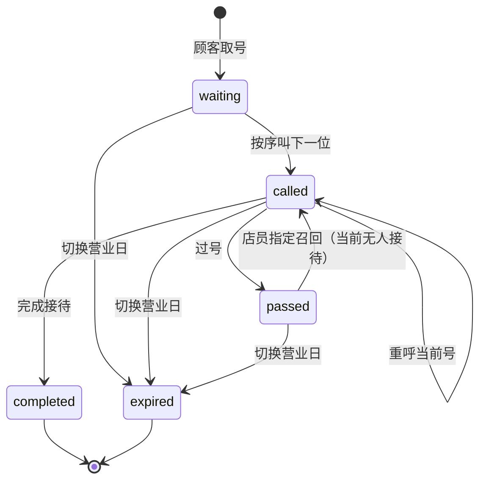
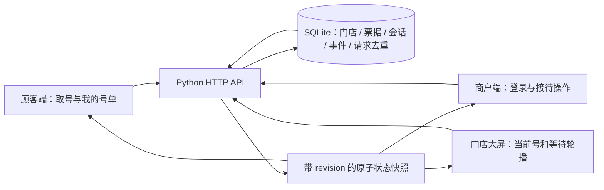

> 历史材料提示：本文保留当时结论与数据；本轮V2.2实施及最新79项测试见[最新报告](V2.2优化实施与系统验收报告.html)。

# 排队叫号系统 · 重构说明与验收报告

版本：2.0　交付日期：2026-10-21

> 历史版本说明：本文记录首次重构交付。本轮V2.1已补齐原版能力并完成53项验收，以[2026-10-22交叉复核报告](交叉复核与演示验收报告.html)为当前结论。本文28项结果对应[首次验收JSON](复核资料/首次验收2026-10-21.json)，当前验证记录目录已更新为V2.1。

## 1. 交付范围

本次根据上一级《业务与功能详细说明》V1.1 中的 G01—G17 问题和 R01—R13 复现场景，重新实现一套可运行的本地 Demo。交付包括四个页面、真实 HTTP API、SQLite 持久化、Windows 启动脚本、使用说明、测试脚本、验证日志和页面截图。

原站点仍是原站点，原源码快照及分析文档保持其历史含义。本目录的修复结论只针对新系统；没有发布或替换 GitHub Pages 上的原 Demo。

## 2. 原问题与新版实现对应

| 原问题 | 新版处理 | 主要验证依据 |
|---|---|---|
| G01 状态 API 404 | 自带可启动的 HTTP 服务，四端共享实际数据库 | HTTP 测试、浏览器完整业务闭环 |
| G02 二维码丢子目录 | 根据模块所在部署根目录生成路径，附加门店参数，本地 SVG 生成 | `/queue/` 下二维码 URL 与 SVG 检查 |
| G03 缺少服务端脚本 | 交付 serve_demo.py、自动寻找 Python 的启动脚本及端口检查 | 全新 8802 端口实际启动、health 返回正常 |
| G04 隐藏大屏入口 | 总入口、工作台侧栏、移动导航直接进入大屏 | 四页面导航和响应式检查 |
| G05 顺序不统一 | SQLite 事务分配 sequence；排位、工作台、大屏统一按它排序 | FIFO、并发唯一编号、顾客前方人数 |
| G06 记录截断 | 工作队列 8 条翻页；档案 10 条翻页；大屏 12 条每 8 秒轮播；CSV 按筛选导出全部记录 | 48 条后端记录、36 条浏览器档案、20 条大屏轮播 |
| G07 无商户登录 | 账号口令、12 小时门店会话、HttpOnly Cookie、服务端权限检查 | 未登录 401、门店会话隔离、会话失效返回登录 |
| G08 局部旧数据未提示 | 单次原子快照，统一连接提示；失败保留最后有效状态并禁用写操作 | 断网提示、按钮禁用、恢复连接 |
| G09 旧响应覆盖新画面 | 服务端 revision 与 serverTime 比较；低版本或同版本更旧快照不应用 | 新号显示后故意放回旧响应，画面保持新号 |
| G10 同设备去重未落实 | 事务查询和数据库部分唯一索引双重约束，一个设备当日一个有效号 | 同设备 30 个并发请求仅得到一个号 |
| G11 恢复请求清掉新指针 | 不再独立保存“我的号单 ID”；state 同时返回设备自己的有效/最新完成号 | 刷新恢复、旧快照回退测试 |
| G12 过号按钮重建绕过禁用 | 独立 busy 操作状态贯穿重绘；服务端请求去重、票据版本、合法状态检查 | 暂挂召回请求后刷新，按钮持续禁用；旧版本拒绝 |
| G13 广播不恢复号单 | 广播触发同一原子快照读取，同时更新队列和我的号单 | 同设备两个标签页即时恢复 H001 |
| G14 语言混用 | 集中词典、storage 事件重渲染整页、同步 document.lang | A 页切英文，B 页静态标题与动态按钮一致 |
| G15 接口结果缺校验 | HTTP 状态、ok 标志、票据/快照类型、业务结果类型与 ID 检查；历史响应检查 | 异常结构保留有效画面；400/401/403/409 结构化失败 |
| G16 时间字符串排序错误 | 排队只使用服务端序号；日期解析为时间戳；统一 UTC+8 显示 | FIFO 不依赖时间字符串；跨日与 ETA 时钟测试 |
| G17 门店和目录未隔离 | 存储键、广播名含部署路径和门店；数据表均按门店隔离；会话限定路径与门店 | 同源两家门店各自 H001、号单 ID 不同、数据互不覆盖 |

R01—R13 所涉及的初始化、恢复、响应顺序、重建按钮、语言、契约和日期归属问题通过上述架构处理。其中原 by-device 接口及其本地 ID 指针已被原子快照取代，新版不保留那套竞态流程。

## 3. 补齐的业务约束

### 3.1 状态与接待规则

当日号码从 H001 递增。waiting、called、passed 均属于有效号，完成后可以重新领取一个新号。每店只能存在一个 called，禁止通过“叫下一位”隐式替换当前顾客。召回过号需明确指定票据和最新版本；不会悄悄改变等待队列顺序。

营业日使用北京时间 UTC+8。跨日首次访问/操作时，将旧的有效号标记 expired 并留存历史，当前顾客页获得新日状态。清空只处理本店当日数据，保留历史及当日号码计数，避免现场出现同日重号。

预计等候按“前方等待人数 × 每位预计时长 + 当前接待的预计剩余时长”计算；前方 0 人也可能需要等待当前接待结束。展示取整后的分钟数并提示仅供参考。统计中的平均接待时长是完成号**最后一次叫号到完成**的平均分钟数，重呼前的等待不计入本轮时长。

### 3.2 持久化和重复请求

SQLite 使用 WAL、事务和唯一索引约束。每次成功写入提升门店 revision，业务结果与去重记录在同一事务提交。客户端写请求包含 requestId；请求已提交但响应丢失时，以同一编号重试返回已处理结果及**当前**快照，不重复叫号。相同请求编号被用于不同内容时拒绝。

票据操作包含 expectedVersion。两位店员处理同一号，只有符合最新版本和当前状态的操作能成功。即使绕过页面禁用，服务端仍会检查权限、当前接待占用和票据状态。

### 3.3 同步和界面状态

页面可见时约每 1.5 秒读取一次，失败退避约 4 秒，恢复前台立即读取。请求设 8 秒超时，轮询串行；同源同店标签页广播加速同步，不同手机通过服务端共享数据。

没有业务变化时保留现有 DOM，避免持续刷新打断点击和输入。门店设置草稿在轮询及请求失败后保留；保存成功才替换为服务端结果。读失败时明确标示数据可能过期；写按钮不允许在离线状态提交。

## 4. 页面与视觉改造

采用暖白、朱红、竹青、浅金配色，统一印章标识、宋体标题、号单卡片、按钮、空状态及提示。

| 页面 | 主要改造 |
|---|---|
| 总入口 | 品牌首屏、实时接待预览、三角色入口、本地二维码与手机地址设置 |
| 顾客端 | 手机优先设计，突出号码、状态、前方人数、预计等候、门店提示与到店步骤 |
| 商户端 | 侧栏导航、四项统计、当前顾客操作区、等待/过号分页、近期动态、档案和设置 |
| 门店大屏 | 竹青深色背景、远距离可读的大号码、完整队列轮播、时钟、全屏和语音开关 |

宽屏、平板、手机布局均有适配，手机商户端使用底部导航。交互保留键盘焦点样式，确认弹窗支持取消、Escape 和 Tab。图标、字体回退及二维码脚本均本地可用，无外部 CDN 请求。

页面截图存放于“验证记录”：总入口.png、顾客端.png、商户工作台.png、门店大屏.png、手机端.png、商户工作台-手机端.png。截图中的号单来自本地服务实际数据。

## 5. 自动化验收结果

验收环境：Windows，Python 3.13.15，Microsoft Edge / Playwright。后端及浏览器测试均使用临时 SQLite；浏览器调用真实 HTTP 服务，并以 `/queue/` 子目录验证路径。异常响应和丢包场景才进行针对性的浏览器拦截。

**共 28 项通过，失败 0，错误 0，跳过 0。** 精确执行时间和逐项结果以 `验证记录/验证结果.json`、`验证记录/自动化验收日志.txt` 为准。

| 分组 | 项数 | 覆盖内容 |
|---|---:|---|
| 事务与业务 | 15 | FIFO、有效号唯一、完成再取、过号召回、版本过期、幂等、并发、跨日、重置、持久化、门店隔离、ETA、参数、分页、会话 |
| HTTP 接口 | 3 | 子目录资源、私有文件不可下载、权限/来源、结构化错误、完整 CSV |
| 真实浏览器 | 10 | 多端闭环、跨标签页恢复、语言、门店隔离、忙碌按钮、旧/坏快照、设置草稿、历史下载、二维码与大屏轮播、断线与会话、语音触发、响应丢失重试、响应式 |

部分具体证据：

- 同设备 30 个并发创建请求仅生成一条有效号；40 个不同设备并发取号得到 1—40 唯一连续序号。
- 8 个并发叫号请求仅一条成功，数据库只存在一个当前接待。
- 36 条浏览器历史可翻到最后 6 条，下载 CSV 含表头共 37 行；后端 48 条记录也完整导出共 49 行。
- 20 个等待号大屏先显示 12 个，8 秒后显示剩余 8 个，首号 H013。
- 请求实际提交后故意丢弃首次响应，浏览器使用原 requestId 重试，叫号次数仍为 1。
- 四页面各在 1440、900、390 像素宽度检查，无整页横向溢出；测试过程中无未捕获页面脚本错误。
- 另已验证启动脚本语法、自动识别 Python、8802 端口启动及 health、8800 已有服务复用；临时启动服务已关闭，8800 用于预览。

## 6. 验收边界与后续使用

本次完成本地 Demo 的业务、数据联动与界面重构。物理手机扫描、实际扬声器出声、语音包兼容和现场 Wi-Fi 防火墙仍需现场测试；自动化语音用例验证的是播报触发和重呼次数。设备 ID 只是浏览器随机标识，清理浏览器存储或换设备会生成新的标识。

当前未扩展预约、支付、会员、短信、多个接待窗口及角色权限分级。没有进行生产压力、外网部署、HTTPS 或生产备份验收。若后续上线运营，应以实际门店规则完善这些能力。

直接从本目录 README.md 和“启动演示.cmd”开始使用。运行无需安装测试库；仅复跑浏览器测试时需要 Playwright。
